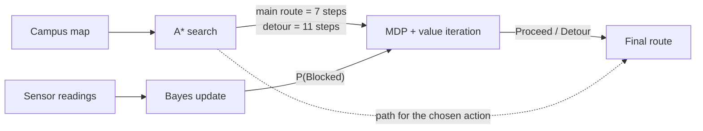
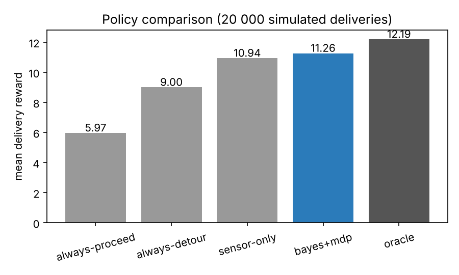
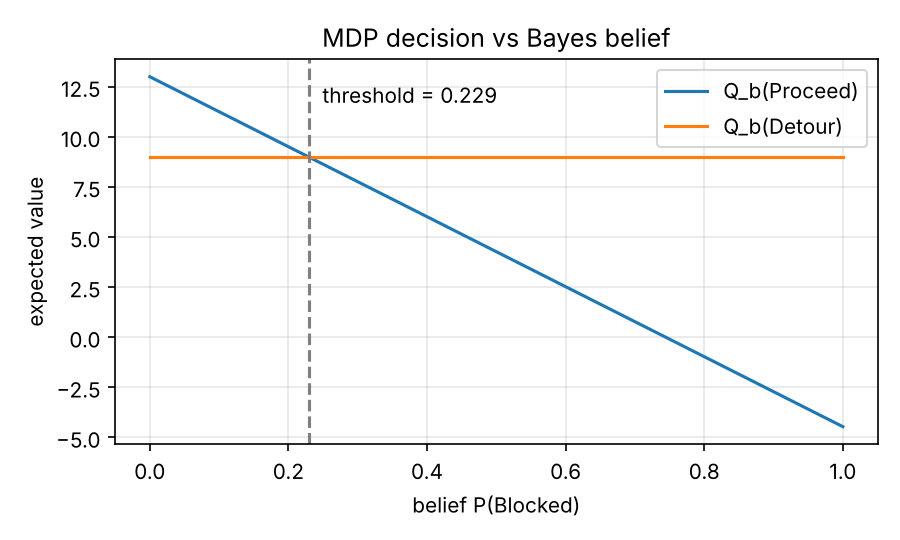
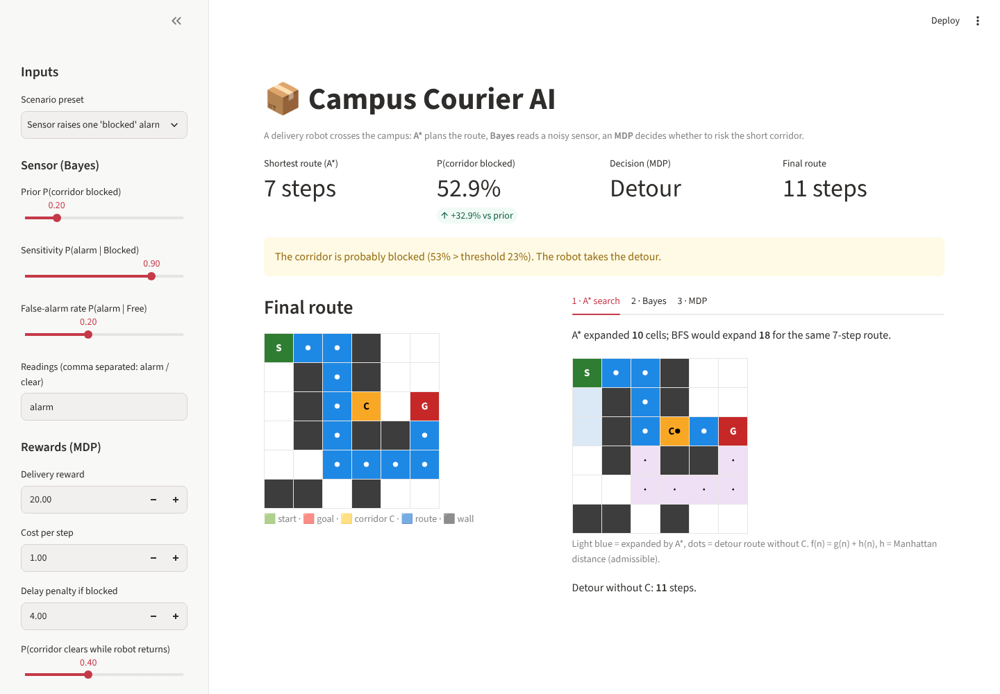

# 📦 Campus Courier AI

[](https://github.com/kailholmsb221/Final/actions/workflows/tests.yml)


**AI Fundamentals — Final Project · QAIRU · Trimester 1, 2026–2027**
Team: **Alikhan Ashimkhan**, **Ansar Amangeldy**

A campus delivery robot has to bring a parcel from the mail room to the dean's office.
The shortest way goes through a narrow corridor that is sometimes blocked, and the only
information about it is a **noisy sensor**. Should the robot risk the short corridor or
take the longer detour?

The project answers this with **three AI algorithms from three different course topics
that feed into each other**:

| # | Course topic | Algorithm | Sub-problem it solves | Output that the next step uses |
|---|---|---|---|---|
| 1 | Search | **A\*** (Manhattan heuristic), BFS as a baseline | Shortest route S → G, and the detour that avoids corridor C | route lengths 7 and 11 → MDP rewards |
| 2 | Probabilistic reasoning | **Bayes' rule** (sequential updates) | How likely is C blocked after noisy sensor readings? | belief P(Blocked) → weights the MDP values |
| 3 | Sequential decision making | **MDP + value iteration** (QMDP decision) | Proceed through C or Detour? | action → selects which A\* route is executed |



---

## Quick start

```bash
git clone https://github.com/kailholmsb221/Final.git
cd Final
python -m venv .venv && source .venv/bin/activate   # Windows: .venv\Scripts\activate
pip install -r requirements.txt

python -m campus_courier              # console demo: all 5 scenarios
streamlit run app.py                  # web UI on http://localhost:8501
python -m pytest -q                   # 235 tests
python -m campus_courier.experiments  # regenerates results/RESULTS.md and charts
```

The core (`campus_courier/`) uses only the Python standard library. `streamlit` is needed
for the UI, `matplotlib` for the charts, `pytest` for the tests. Python 3.10+.

### Console options

```bash
python -m campus_courier --scenario alarm                    # one preset scenario
python -m campus_courier --readings alarm clear --prior 0.1  # your own readings
python -m campus_courier --readings alarm --sensitivity 0.95 --false-alarm 0.05
```

Presets: `no-sensor`, `clear`, `alarm`, `two-alarms`, `mixed`.

---

## Sample input / output

**Input** (all values are stated assumptions, no real dataset is used):

```
Map 6x6                 S = mail room (0,0)    G = dean's office (2,5)
S . . # . .             C = monitored corridor (2,3)    # = wall
. # . # . .
. # . C . G             Prior P(Blocked) = 0.20
. # . # # .             Sensor: P(alarm | Blocked) = 0.90, P(alarm | Free) = 0.20
. . . . . .             Reading: alarm
# # . # . .             Rewards: delivery +20, -1 per step, -4 delay if blocked,
                        P(corridor clears) = 0.4, gamma = 0.9
```

**Output** of `python -m campus_courier --scenario alarm` (shortened):

```
[1] A* SEARCH  (heuristic: Manhattan distance)
  steps : A* expanded 10 cells, BFS would expand 18
  output: shortest route, 7 steps: (0,0) -> (0,1) -> (0,2) -> (1,2) -> (2,2) -> (2,3) -> (2,4) -> (2,5)
  detour: corridor C=(2, 3) removed, 11 steps

[2] BAYESIAN INFERENCE  (is the corridor blocked?)
  step 1: P(Blocked | alarm) = 0.90 x 0.200 / (0.90 x 0.200 + 0.20 x 0.800) = 0.1800 / 0.3400 = 0.5294

[3] MDP + VALUE ITERATION  (Proceed through C or Detour?)
  steps : converged after 2 iterations; V(Free) = 13.00, V(Blocked) = 9.00
          Q(Free,Proceed) = 13.00, Q(Free,Detour) = 9.00
          Q(Blocked,Proceed) = -4.46, Q(Blocked,Detour) = 9.00
          belief-weighted values with b = 0.529: Proceed: 3.76, Detour: 9.00
          Detour is better whenever P(Blocked) > 0.229
  output: ACTION = Detour

FINAL ROUTE (11 steps)
S * * # . .
. # * # . .
. # * C . G
. # * # # *
. . * * * *
# # . # . .
```

| Scenario | Readings | P(Blocked) | Action | Route |
|---|---|---|---|---|
| no-sensor | — | 0.200 | Proceed | 7 steps |
| clear | clear | 0.030 | Proceed | 7 steps |
| alarm | alarm | 0.529 | **Detour** | 11 steps |
| two-alarms | alarm, alarm | 0.835 | **Detour** | 11 steps |
| mixed | alarm, clear | 0.123 | Proceed | 7 steps |

---

## How each algorithm works (short)

**1. A\*** expands the cell with the smallest `f(n) = g(n) + h(n)`, where `g` is the
number of steps from the start and `h` is the Manhattan distance to the goal. On a
4-connected grid with unit costs `h` never overestimates, so the first path that reaches
the goal is optimal. A\* runs twice: on the real map (main route) and on a copy where C is
an obstacle (detour). BFS runs only as a baseline for comparison.

**2. Bayes' rule**
`P(B|e) = P(e|B)P(B) / (P(e|B)P(B) + P(e|¬B)P(¬B))`. One alarm raises the belief from
0.20 to 0.53, a second one to 0.84. A `clear` reading lowers it to 0.03. Readings are
assumed conditionally independent given the true state, so each posterior becomes the next prior.

**3. MDP.** States `{Free, Blocked, Delivered}`, actions `{Proceed, Detour}`, rewards built
from the A\* lengths: delivering by the main route gives `20 − 7 = 13`, by the detour
`20 − 11 = 9`. Proceeding into a blocked corridor wastes the trip there and back plus a
delay (`−(2·5 + 4) = −14`), after which the corridor is free with probability 0.4.
Value iteration solves the Bellman equation, giving `Q(s, a)`. The robot does not know
the true state, so it uses the Bayes belief `b`:
`Q_b(a) = b·Q(Blocked, a) + (1 − b)·Q(Free, a)` and picks the larger value (QMDP). The two
lines cross at **b = 0.229**, which is the risk threshold.

A full explanation with every formula is in [docs/REPORT.md](docs/REPORT.md).

---

## Testing and results

* **235 automated tests** (`pytest`): hand-calculated Bayes posteriors and Q-values,
  A\* optimality against BFS on 200 random maps, admissibility of the heuristic, the
  Bellman equation at convergence, the decision flipping exactly at the threshold,
  edge cases (unreachable goal, no detour, impossible evidence, invalid input) and the CLI.
  CI runs them on every push (GitHub Actions).
* **A\* vs BFS** on random maps: identical optimal path length on 100% of solvable maps,
  51–79% fewer expanded cells.
* **20 000 simulated deliveries** compare decision policies (mean reward, higher is better):

| always-proceed | always-detour | sensor-only | **bayes+mdp (ours)** | oracle (knows the truth) |
|---|---|---|---|---|
| 5.97 | 9.00 | 10.94 | **11.26** | 12.19 |

Bayes+MDP is the best non-oracle policy for every prior from 0.05 to 0.8.
Full tables and charts: [results/RESULTS.md](results/RESULTS.md).

<p>


</p>

---

## User interface

`streamlit run app.py` opens a dashboard where every input is a control: prior, sensor
accuracy, readings, rewards, γ and the map itself. The page shows the final route and one
tab per algorithm with its intermediate steps (A\* expanded cells and detour, Bayes
formula and belief chart, Q-table, decision curve and value-iteration history).



---

## Project structure

```
campus_courier/
  grid.py         map parsing, neighbours, rendering
  search.py       A* and BFS (topic 1)
  bayes.py        sensor model and Bayes' rule (topic 2)
  mdp.py          generic MDP, value iteration, courier MDP, QMDP decision (topic 3)
  pipeline.py     connects the three algorithms into one mission
  scenarios.py    campus map and the five demo scenarios
  cli.py          console demo (python -m campus_courier)
  experiments.py  benchmarks and simulation for the report
app.py            Streamlit UI
tests/            pytest suite (235 tests)
results/          generated tables and charts
docs/             report, AI-usage declaration, team statement, demo script
```

## Deliverables

| Deliverable | Where |
|---|---|
| Working application and demo | `python -m campus_courier`, `streamlit run app.py` |
| GitHub repository | this repo |
| Technical report | [docs/REPORT.md](docs/REPORT.md) |
| 5–7 slide presentation (PDF) | [docs/slides/Campus_Courier_AI_slides.pdf](docs/slides/Campus_Courier_AI_slides.pdf) |
| 2–3 minute demo video (2:17) | [docs/video/campus_courier_demo.mp4](docs/video/campus_courier_demo.mp4) |
| AI usage declaration | [docs/AI_USAGE.md](docs/AI_USAGE.md) |
| Team contribution statement | [docs/TEAM.md](docs/TEAM.md) |
| Defense plan and demo script | [docs/DEMO_SCRIPT.md](docs/DEMO_SCRIPT.md) |
| Explanation and defense Q&A in Russian | [docs/ru/](docs/ru/) |

## Assumptions and limitations

* Toy 6×6 map, unit step cost, 4-connected moves; probabilities and rewards are chosen by
  hand (no real sensor data), as the course guidelines allow.
* Sensor readings are conditionally independent given the corridor state.
* QMDP assumes the state becomes known after the next step, so it does not value
  "waiting to gather more information". A POMDP solver would handle that exactly.
* Only one corridor is uncertain; with several, the MDP state would be the combination.

## Future work

Real map of the QAIRU building, several uncertain corridors, an HMM over time
(the corridor state changes during the day), learning the sensor model from logged data,
and running it on a physical robot.

## License

MIT — see [LICENSE](LICENSE).
