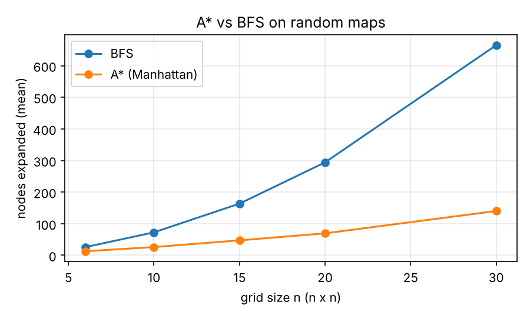
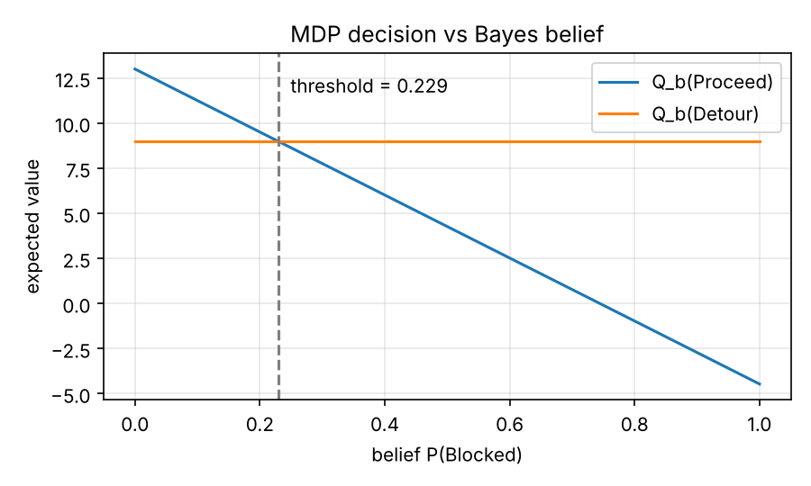
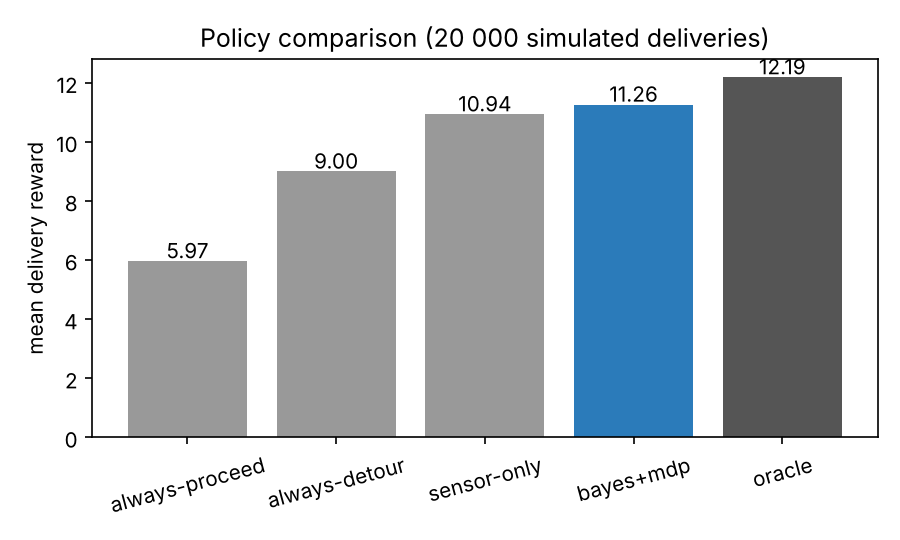

# Results

Generated by `python -m campus_courier.experiments` (fixed seeds).

## 1. Demo scenarios on the campus map

| Scenario | Readings | P(Blocked) | Q_b(Proceed) | Q_b(Detour) | Action | Route length |
|---|---|---|---|---|---|---|
| no-sensor | — | 0.200 | 9.51 | 9.00 | Proceed | 7 |
| clear | clear | 0.030 | 12.47 | 9.00 | Proceed | 7 |
| alarm | alarm | 0.529 | 3.76 | 9.00 | Detour | 11 |
| two-alarms | alarm, alarm | 0.835 | -1.58 | 9.00 | Detour | 11 |
| mixed | alarm, clear | 0.123 | 10.85 | 9.00 | Proceed | 7 |

Decision threshold: Detour is chosen when P(Blocked) > **0.229**.

## 2. A* vs BFS (random n x n maps, 25% walls, 200 maps per size)

| n | solvable maps | BFS nodes | A* nodes | A* saves | A* cost = BFS cost |
|---|---|---|---|---|---|
| 6 | 143 | 26.0 | 12.7 | 51% | 100% |
| 10 | 132 | 72.6 | 26.0 | 64% | 100% |
| 15 | 137 | 163.5 | 47.2 | 71% | 100% |
| 20 | 131 | 294.1 | 69.5 | 76% | 100% |
| 30 | 135 | 664.9 | 140.1 | 79% | 100% |

A* always returns a path of the same (optimal) length as BFS, but expands far fewer cells.

## 3. Policy comparison (20 000 simulated deliveries, prior 0.2, one reading)

| Policy | Mean reward | Mean steps | Detour rate |
|---|---|---|---|
| always-proceed | 5.97 | 12.02 | 0.0% |
| always-detour | 9.00 | 11.00 | 100.0% |
| sensor-only | 10.94 | 8.87 | 34.4% |
| bayes+mdp | 11.26 | 8.66 | 36.7% |
| oracle | 12.19 | 7.81 | 20.2% |

`oracle` knows the true corridor state and is an upper bound; `sensor-only` trusts the raw reading without Bayes or the MDP.

## 4. Does Bayes matter? Mean reward for different priors

| prior P(Blocked) | always-proceed | always-detour | sensor-only | bayes+mdp | oracle |
|---|---|---|---|---|---|
| 0.05 | 11.15 | 9.00 | 11.86 | 12.08 | 12.81 |
| 0.10 | 9.33 | 9.00 | 11.58 | 11.74 | 12.61 |
| 0.20 | 5.90 | 9.00 | 10.86 | 11.27 | 12.21 |
| 0.40 | -0.68 | 9.00 | 9.73 | 10.36 | 11.41 |
| 0.60 | -8.10 | 9.00 | 8.48 | 9.38 | 10.60 |
| 0.80 | -14.88 | 9.00 | 7.20 | 9.00 | 9.81 |

Bayes+MDP has the best mean reward of all non-oracle policies at every prior. Where the gain comes from: (a) at prior 0.05 one alarm only raises P(Blocked) to 0.19 (below the 0.229 threshold), so the robot keeps the short route while `sensor-only` detours on a likely false alarm; (b) at prior 0.8 even a `clear` reading leaves P(Blocked) = 0.33, so it detours instead of walking into a corridor that is probably blocked; (c) at every prior, after hitting a blocked corridor it updates its belief and detours instead of retrying the same corridor.

## 5. Belief after k consecutive alarms

| k | P(Blocked) |
|---|---|
| 0 | 0.200 |
| 1 | 0.529 |
| 2 | 0.835 |
| 3 | 0.958 |
| 4 | 0.990 |

## Charts

